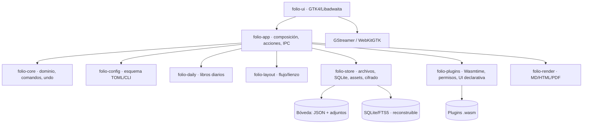

# Plan director — Folio

**Aplicación nativa de notas para Linux, con libros diarios, lienzo infinito y plugins.**

| Campo | Valor |
|---|---|
| Versión del plan | 1.0 |
| Fecha | 29/10/2026 |
| Autor | Usuario + agente |
| Estado | Listo para ejecución; decisiones menores con defecto documentado |
| Nombre provisional | Folio (`folio`) |
| Plataforma objetivo | Linux x86_64, GNOME/Wayland; X11 como compatibilidad |
| Stack | Rust + GTK4 + Libadwaita |
| Horizonte MVP | 14 semanas (1 desarrollador) |
| Horizonte 1.0 | 20 semanas |

---

## 1. Resumen ejecutivo

Folio es un cuaderno diario y un sistema de notas a la vez. Cada día genera un **libro** —renombrable, configurable o creado a mano— que contiene notas ilimitadas. Cada nota es un **lienzo infinito** que, por defecto, se comporta como un documento lineal cómodo de escribir; cualquier bloque puede arrastrarse y anclarse en el espacio, y un comando «Recomponer» devuelve todo al flujo. Las notas admiten texto enriquecido, tablas, dibujos, audio, vídeo, páginas web, archivos y bloques de plugin.

La aplicación se construye sobre **Rust y GTK4/Libadwaita** para lograr arranque rápido, memoria contenida e integración nativa. El contenido vive en **archivos JSON versionados con adjuntos direccionados por contenido**, y SQLite actúa solo como índice reconstruible: si el índice se corrompe, se regenera; si la app desaparece, los datos siguen legibles. La configuración es un **TOML comentado** editable a mano o desde una GUI generada a partir del mismo esquema y desde la CLI, con recarga en vivo.

Los plugins son **WebAssembly (Wasmtime)** con una API tipada en WIT, UI declarativa renderizada de forma nativa y permisos por capacidad. El MVP incluye tres plugins de referencia —barra de progreso, gráficas y diagramas—; 1.0 añade barra rápida y estadísticas hasta completar cinco.

La ruta se divide en 14 etapas dentro de un calendario de 14 semanas, con puertas de calidad. Cada etapa deja una aplicación ejecutable, datos íntegros y una prueba automatizada de lo construido. El MVP se define por un escenario de extremo a extremo, no por una lista de pantallas.

---

## 2. Decisiones cerradas con el usuario

| # | Pregunta | Decisión |
|---|---|---|
| D-01 | Stack | Rust + GTK4/Libadwaita; editor propio, sin WebView para el documento |
| D-02 | Modelo de nota | Lienzo infinito con **flujo por defecto**; los bloques se anclan al arrastrar; «Recomponer» vuelve al flujo |
| D-03 | Almacenamiento | Archivos legibles + índice SQLite reconstruible |
| D-04 | Plugins | WASM + UI nativa declarativa + permisos |
| D-05 | Sincronización | Local primero; sync después; decidir backend en la etapa 14 |
| D-06 | Cifrado | Bóveda cifrada **opcional**, no obligatoria |
| D-07 | Plazo | Solo el usuario; MVP en 10–14 semanas; plan base de 14 |
| D-08 | Libros diarios | Creación perezosa; sin rellenar días vacíos; relleno manual bajo demanda |
| D-09 | Web y medios | Tarjeta de enlace + vista viva opcional bajo demanda; medios locales con GStreamer |
| D-10 | Exportación | Markdown, HTML y PDF; importación Markdown |
| D-11 | Idioma | Español primero; infraestructura i18n preparada |
| D-12 | Sync futura | Sin backend decidido; el modelo se prepara para CRDT |

Las decisiones de ingeniería derivadas están en [docs/10-decisiones.md](docs/10-decisiones.md). Las dudas menores que no bloquean el arranque están en [docs/11-preguntas-abiertas.md](docs/11-preguntas-abiertas.md).

---

## 3. El producto en una página

### 3.1 Libros

- **Libro diario automático**: se crea al abrir la app por primera vez en el día lógico (configurable a «primera nota» o «manual»). Título por defecto `29/10/2026`; carpeta `2026-10-29`; ambos formatos configurables. La hora de corte por defecto es las 04:00 locales para que una nota de madrugada pertenezca al día anterior.
- **Libros manuales**: creación libre, título libre, mismo modelo que los diarios.
- **Renombrar no rompe la automatización**: el libro guarda `daily_date`; el título es solo presentación. Si se renombra, no se crea un duplicado.
- **Sin duplicados ni libros vacíos retroactivos**: los días no abiertos no generan libros; existe «Generar libros faltantes» con rango de fechas.
- **Operaciones**: renombrar, icono/color, fijar, archivar, papelera, exportar, mover notas.

### 3.2 Notas

- Ilimitadas en número y tamaño práctico; la lista se virtualiza y el contenido se carga bajo demanda.
- Título editable; si está vacío se deriva de la primera línea.
- Orden **manual** (libre) por defecto, con arrastrar y soltar dentro del libro y entre libros.
- Otros órdenes: título A–Z/Z–A, creación, modificación, tamaño. Son vistas; no destruyen el orden manual.
- Arrastrar sobre un libro de la barra lateral durante ~650 ms lo abre (spring-load); se elige la posición exacta con líneas de inserción y un selector. También existe «Mover a…» por teclado.
- Papelera con restauración, historial de versiones y copias automáticas.

### 3.3 Editor híbrido

- **Flujo**: columna de documento centrada, ancho configurable, tipografía cómoda, atajos Markdown, barra de formato contextual y menú `/`.
- **Lienzo infinito**: zoom 25–400 %, paneo, selección múltiple, guías de alineación, rejilla opcional, orden Z y encuadre.
- **Anclaje**: al arrastrar un bloque desde el flujo queda «anclado» en coordenadas del mundo; los demás bloques cierran el hueco. «Volver al flujo» lo reinserta; «Recomponer» ordena todos los bloques por posición visual y limpia anclajes.
- **Encuadre documento**: `Ctrl+1` centra la columna; «Encuadre todo» `Ctrl+2` muestra también los bloques libres.
- **Bloques**: texto enriquecido (párrafos, H1–H3, listas, checklists, citas, código), tabla, imagen, audio, vídeo, archivo, tarjeta web, vista web viva opcional, dibujo vectorial y bloque de plugin.
- **Modo previsualización** de solo lectura, con medios reproducibles y plugins en modo lectura.

### 3.4 Plugins

- Lógica aislada en WASM; UI descrita como árbol declarativo y renderizada con widgets nativos.
- Tipos de extensión: bloque, panel lateral, comando de paleta, importador/exportador, tema (tokens) y ajustes.
- Permisos declarados y concedidos por el usuario: leer notas, escribir solo su bloque, almacenamiento propio, red, portapapeles, notificaciones.
- Los plugins de ejemplo cubren los casos pedidos: **barra** (progreso y barra rápida), **gráficas** (barra/línea/tarta), **diagramas** (DSL con layout automático), además de estadísticas diarias.
- Sin red por defecto, sin acceso al sistema de archivos, con límites de memoria y tiempo de CPU.

### 3.5 Configuración

- Archivo `config.toml` global y `vault.toml` por bóveda, comentados y editables.
- GUI generada desde el mismo esquema, con búsqueda y formulario por campo; editor TOML avanzado integrado y opción de abrir en `$EDITOR`.
- CLI `folio config get/set/edit/validate/schema`.
- Precedencia: flags CLI > entorno `FOLIO_*` > bóveda > global > valores por defecto.
- Recarga en vivo: si el TOML es inválido, se conserva la última configuración válida y se muestra el error con número de línea.

---

## 4. Alcance

### 4.1 MVP (obligatorio)

| Área | Incluido |
|---|---|
| Bóveda | Crear/abrir/cambiar; ruta libre; bloqueo de instancia; índice reconstruible |
| Libros | Diarios configurables, manuales, renombrar, archivar, papelera, orden de notas |
| Notas | Ilimitadas, título, orden manual y alternativo, DnD intra/interlibro, spring-load, selector de posición |
| Editor | Texto enriquecido, formato, listas, checklists, citas, código, tablas básicas, imágenes, audio, vídeo, archivos, web card, dibujo básico |
| Lienzo | Flujo por defecto, anclaje, recomposición, zoom, paneo, guías, multiselección |
| Plugins | Host WASM, SDK Rust, UI declarativa, permisos, gestor, 3 ejemplos (progreso, gráficas, diagramas) |
| Búsqueda | FTS5, filtros por libro/fecha/tipo, resaltado |
| Exportación | Markdown y HTML; importación Markdown |
| Seguridad | Sandbox de plugins, rutas seguras, backups, papelera, historial; web viva aislada en 1.0 |
| UX | Tema claro/oscuro, atajos, paleta de comandos, accesibilidad básica, español |
| Entrega | Flatpak, AUR, AppStream, documentación |

### 4.2 1.0 (después del MVP, semanas 15–20)

Bóveda cifrada y bloqueo automático; vista web viva; exportación PDF con canvas; plugins `quickbar` y `stats`; `.deb`; auditoría de accesibilidad; SDK de plugins congelado y documentado; cierre de la beta de 30 días; certificación de rendimiento.

### 4.3 Fuera de alcance (explícito)

Sincronización en tiempo real, colaboración, móvil, Windows/macOS, DOCX, OCR, reconocimiento de escritura, IA, marketplace de plugins, correo, calendario, backlinks/grafo, temas CSS arbitrarios. Todo ello tiene sitio en el backlog posterior, pero **no entra en el MVP**.

---

## 5. Principios rectores

1. **Los datos sobreviven a la app.** Archivos legibles, esquema versionado, exportación siempre disponible.
2. **Primero la integridad.** Escritura atómica, `fsync`, papelera, versiones y pruebas de `kill -9`.
3. **Nada bloquea la UI.** IO, indexación, cifrado y plugins fuera del hilo de GTK.
4. **Fundamento antes que pantalla.** Cada etapa añade una capa probada sobre la anterior.
5. **Nativo de verdad.** Sin Electron; widgets GTK, Pango y GStreamer; WebView solo para web incrustada.
6. **Permisos, no confianza.** Plugins y web son contenido no confiable por definición.
7. **Configuración total.** Todo lo que se puede configurar se puede hacer por texto y por GUI.
8. **Reversible.** Undo, papelera, versiones y backups; ninguna acción destructiva sin retorno.
9. **Teclado primero, ratón también.** El lienzo tiene alternativa completa por teclado.
10. **Rendimiento medido.** Presupuestos numéricos y CI que falla si se degradan.

---

## 6. Arquitectura de un vistazo



| Crate | Responsabilidad | Puede depender de |
|---|---|---|
| `folio-core` | Modelo, IDs, comandos, validación, undo | std, serde |
| `folio-store` | Bóveda, escritura atómica, índice, assets, cifrado | core |
| `folio-config` | Esquema, TOML, precedencia, validación | core |
| `folio-daily` | Cálculo de día lógico, patrones, plantillas | core |
| `folio-layout` | Geometría flujo/libre, hit-testing, recomposición | core |
| `folio-render` | Exportadores MD/HTML/PDF | core, layout |
| `folio-plugins` | Host WASM, manifiesto, permisos, UI schema | core |
| `folio-ui` | Widgets, editor, lienzo, pantallas | core, layout, config, plugins |
| `folio-app` | Binario, servicios, acciones, D-Bus/CLI | todos |
| `folio-plugin-sdk` | SDK Rust + bindings WIT | WIT |

Regla dura: `folio-core`, `folio-store`, `folio-daily`, `folio-layout` y `folio-plugins` **no dependen de GTK**. Se prueban sin pantalla y se pueden usar desde la CLI.

---

## 7. Modelo de datos de un vistazo

```text
vault/
├── vault.toml                  # metadatos y configuración de la bóveda
├── .folio/
│   ├── index.sqlite            # índice reconstruible (WAL)
│   ├── lock                    # instancia única
│   ├── backups/                # snapshots por hardlinks
│   ├── trash/                  # papelera con metadatos
│   └── quarantine/             # archivos corruptos, nunca se borran solos
├── books/
│   └── 2026-10-29_a1b2c3/
│       ├── book.toml           # título, daily_date, icono, orden
│       └── notes/
│           └── 0V3k_01J...json # <order_key>_<note_id>.json
├── assets/
│   └── ab/cd/<blake3>.<ext>    # contenido direccionado
└── plugins/                    # plugins instalados
```

- **Nota**: JSON con `schema`, `id`, `title`, `blocks[]`, `layout`, metadatos. Cada bloque tiene `id`, `type`, `placement` (`flow` o `free {x,y,w}`) y contenido tipado.
- **Pertenencia a libro**: la carpeta. **Orden**: el prefijo `order_key` del nombre de archivo (LexoRank/base62). Mover una nota entre libros es un `rename` atómico dentro del mismo sistema de archivos.
- **Adjuntos**: BLAKE3, deduplicados, referenciados por hash; nunca se ejecutan.
- **Índice**: SQLite con FTS5; se reconstruye desde los archivos con `folio doctor --rebuild-index`.
- **Esquema versionado**: migraciones explícitas; campos desconocidos se preservan; bloques de plugin ausentes se muestran como marcador, no se borran.

Detalle completo, esquemas y SQL en [docs/03-modelo-datos.md](docs/03-modelo-datos.md).

---

## 8. Hoja de ruta de 14 semanas

| Etapa | Días | Semana | Resultado visible | Puerta de calidad |
|---|---|---|---|---|
| E0 Fundamentos | 3 | 1 | Repo, CI, ventana GTK, automatización aislada, presupuestos, ADRs | Compila limpio; CI verde; benchmark base |
| E1 Almacenamiento | 7 | 1–2 | Bóveda, libros/notas, índice, doctor | Roundtrip; `kill -9` sin corrupción; 10k notas indexadas |
| E2 Shell | 4 | 3 | Navegación, crear/renombrar, paleta | 60 fps; teclado completo; instancia única |
| E3 Diarios + config | 5 | 3–4 | Libro de hoy, formatos, GUI/TOML/CLI | DST, cambio de zona, renombrado sin duplicado |
| E4 Editor texto | 8 | 4–6 | Texto rico, undo, autosave, recuperación | p95 < 16 ms; IME; 100 pasos de undo |
| E5 Lienzo híbrido | 8 | 6–7 | Flujo, anclaje, zoom, recomposición | 500 bloques a 60 fps; hit-testing correcto |
| E6 Orden y DnD | 4 | 8 | Orden libre, spring-load, selector | 100 movimientos sin pérdida; undo |
| E7 Medios y web card | 5 | 8–9 | Imagen, audio, vídeo, archivo, tarjeta web | Límites de memoria; red apagada por defecto |
| E8 Dibujo y tablas | 5 | 9–10 | Trazo básico, tablas | 10k trazos; tabla 100×20 fluida |
| E9 Buscar/preview/export | 4 | 10–11 | FTS, lectura, MD/HTML | < 80 ms en 10k notas; golden files |
| E10 Plugins | 6 | 11–12 | Host, SDK, 3 ejemplos, gestor | Sandbox; crash aislado; API congelada |
| E11 Backups/robustez | 4 | 13 | Papelera, versiones, backups, reparación | Restore probado; caos sin corrupción |
| E12 Pulido | 3 | 13–14 | Accesibilidad, rendimiento, onboarding | Presupuestos; checklist; soak 2 h |
| E13 Beta/entrega | 4 | 14 | Flatpak, AUR, docs, RC | Instalación limpia; release firmada |
| **Total MVP** | **70** | **14** | **App usable a diario** | **Escenario de aceptación** |
| 1.0 | 30 | 15–20 | Cifrado, web viva, PDF, 5 plugins, deb, auditoría | Release estable |

Cada etapa tiene pasos de 1–3 días, entregables, criterios verificables y demo. Ver [docs/09-hoja-de-ruta.md](docs/09-hoja-de-ruta.md).

### 8.1 Si el calendario aprieta

Orden de recorte, de menor a mayor impacto:

1. Tablas avanzadas (CSV masivo, fusión) → tabla simple.
2. Presión de stylus → ratón/trackpad.
3. Paneles de plugin → solo bloques y comandos.
4. AUR → solo Flatpak en el MVP (`.deb` ya es 1.0).
5. Backfill automático → solo manual.
6. Dibujo vectorial avanzado (capas, borrado por punto) → trazo básico.

La vista web viva, el PDF, el cifrado, `quickbar`/`stats` y `.deb` ya están planificados para 1.0, no son recortes del MVP.

**Nunca se recorta**: integridad de archivos, undo, backups, búsqueda, DnD, configuración por texto/GUI, sandbox de plugins, pruebas de corrupción, libros diarios, editor y lienzo base.

---

## 9. Presupuestos de rendimiento

Hardware de referencia: portátil 4 núcleos, 8 GB RAM, SSD, 1080p, GNOME/Wayland.

| Métrica | Objetivo | Medición |
|---|---|---|
| Arranque en frío hasta interactivo | < 600 ms p95 | `hyperfine`, marca interna |
| Arranque en caliente | < 250 ms | idem |
| RAM con 10k notas / 100k bloques | < 150 MB | `/proc/self/status`, heaptrack |
| Abrir nota de 5k palabras | < 100 ms | traza |
| Latencia de tecleo | < 16 ms p95 | instrumentación |
| Paneo/zoom con 500 bloques | 60 fps | frame timing |
| Búsqueda en 10k notas | < 80 ms | criterion + vault sintética |
| Guardado de nota | < 30 ms | traza |
| CPU en reposo | < 0,5 % | `powertop`/`pidstat` |
| Binario stripped | < 35 MB | `ls -lh` |
| Memoria de plugin | ≤ 64 MB por plugin | StoreLimits |

Estrategias: virtualización de listas y bloques, texturas cacheadas, layout solo de lo visible, indexación en segundo plano, debounce, pausa de medios fuera de pantalla, sin polling, WebView solo bajo demanda. Detalle en [docs/07-seguridad-rendimiento.md](docs/07-seguridad-rendimiento.md).

---

## 10. Riesgos principales

| Riesgo | Prob. | Impacto | Mitigación |
|---|---|---|---|
| El editor híbrido es más complejo de lo previsto | Alta | Alto | Spike de 3 días en E4 con 3 opciones y criterio de salida; fallback a edición por bloque con overlay |
| Zoom/hit-testing de widgets GTK en canvas | Media | Alto | Prototipo E5; si falla, render de previews + editor superpuesto |
| Un solo desarrollador y 14 semanas | Alta | Alto | Must/Should, recortes definidos, puertas semanales |
| API de plugins se desborda | Media | Medio | WIT v1 congelada en E10; 3 ejemplos como contrato |
| WebKit consume RAM o amplía ataque | Media | Medio | Carga bajo demanda, perfil efímero, proceso aislado, sin cookies; web viva en 1.0 |
| Pérdida de datos por escritura/energía | Baja | Crítico | Temp + fsync + rename, journal de operaciones, pruebas `kill -9`, backups |
| Cifrado complica búsqueda | Media | Medio | SQLCipher + índice descifrado en memoria; etapa de 1.0 con prueba dedicada |
| Deriva visual por usar muchos widgets nativos | Media | Bajo | Tokens de diseño, capturas de referencia, revisión semanal |

---

## 11. Definición de éxito

### 11.1 Escenario de aceptación del MVP

En una instalación limpia de Arch/GNOME:

1. Abro Folio, creo una bóveda en `~/Notas` y veo el libro de hoy `29/10/2026`.
2. Escribo una nota con título, texto en negrita, una lista, una tabla, una imagen y un dibujo.
3. Arrastro un bloque fuera del flujo: queda anclado; los demás se recomponen; `Ctrl+1` vuelve al encuadre documento; «Recomponer» lo devuelve al flujo.
4. Creo un libro «Proyectos», arrastro la nota desde el libro de hoy y, al mantenerla sobre «Proyectos» 650 ms, se abre; elijo la posición 2 y suelto.
5. Cambio el formato del título diario a `%Y/%m/%d` desde la GUI, y el de la carpeta a `%d-%m-%Y` editando `vault.toml`; ambos cambios se reflejan sin reiniciar.
6. Inserto una barra de progreso, una gráfica que lee la tabla y un diagrama con su DSL; interactúo con los tres.
7. Inserto una tarjeta web; con red se obtienen metadatos y sin red veo el fallback o lo ya cacheado. La vista viva es 1.0.
8. Exporto a HTML y a Markdown; abro ambos y compruebo que el contenido, los medios y las posiciones del canvas están representados (PDF en 1.0).
9. Cierro con `kill -9`, vuelvo a abrir: todo está intacto y la recuperación no muestra pérdidas.
10. Busco una palabra del texto y encuentro la nota con su fragmento resaltado; los medios se localizan por nombre y tipo.
11. La app arranca en < 600 ms y no supera 150 MB con la bóveda de prueba.

Si los 11 pasos pasan, el MVP existe. El resto es 1.0: bóveda cifrada, web viva, PDF, `quickbar`/`stats`, `.deb` y auditoría de accesibilidad. El escenario de 1.0 añade esos pasos sin cambiar los datos.

### 11.2 Métricas de producto

- Uso diario durante 14 días seguidos sin pérdida de datos.
- 0 corrupciones en pruebas de caos.
- ≥ 99 % de sesiones sin crash en beta.
- Búsqueda percibida como instantánea.
- Un plugin de terceros puede construirse siguiendo solo la documentación.

---

## 12. Cómo se trabaja este plan

- **Semana**: lunes se elige la etapa y se desglosan sus pasos en tareas de ≤ 1 día; viernes se hace demo y se actualiza el estado.
- **Cada etapa**: empieza con una rama corta, termina con CI verde, demo, checklist manual y ADR si hubo decisión nueva.
- **Cada bug de datos**: se convierte en prueba de regresión antes de corregirse.
- **Cada configuración nueva**: se añade al esquema, a la GUI, a la CLI y a la prueba de paridad.
- **Cada plugin nuevo**: pasa por el arnés de conformidad y las pruebas de permisos.
- **Cada test de UI**: se ejecuta en un Xvfb privado con D-Bus/XDG temporales; nunca en el display del usuario. Ver [docs/15-automatizacion.md](docs/15-automatizacion.md).
- **Suites largas**: `keep-awake.sh`/`nightly.sh` bloquean la suspensión; la pantalla puede apagarse y el trabajo continúa.

La primera acción concreta está en [docs/13-primeros-pasos.md](docs/13-primeros-pasos.md).
