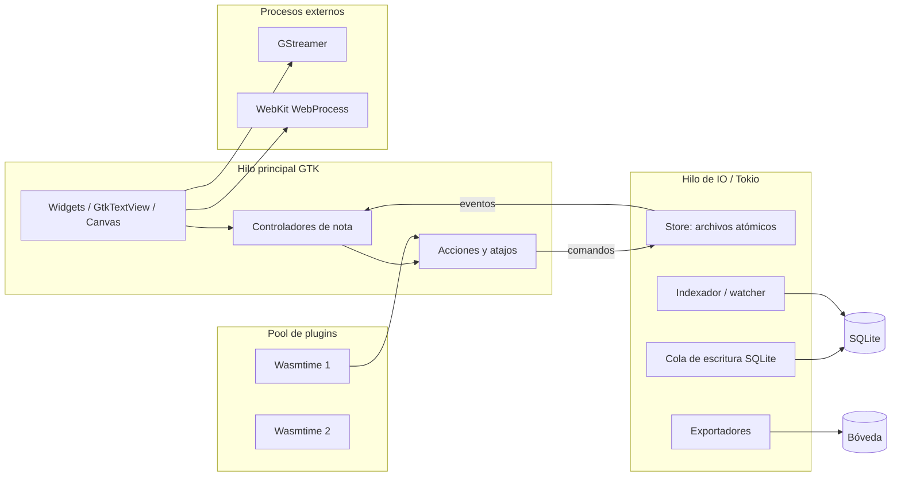

# 02 — Arquitectura técnica

## 1. Objetivo de la arquitectura

Sostener tres promesas al mismo tiempo:

1. **Rapidez y bajo consumo**: arranque corto, memoria acotada, UI a 60 fps.
2. **Integridad y portabilidad**: archivos legibles, escritura atómica, índice reconstruible.
3. **Extensibilidad segura**: plugins aislados, web aislada, capacidades explícitas.

La arquitectura evita dos extremos: no usa un motor web para el editor (coste de RAM y dependencia de un navegador) ni construye todo desde cero (reinventar accesibilidad, IME y portapapeles). Usa GTK4 para la plataforma, Pango para texto y un modelo de dominio propio para la semántica del documento.

## 2. Stack y versiones

| Componente | Elección | Notas |
|---|---|---|
| Lenguaje | Rust estable, edición 2024 | Sin `unsafe` salvo wrappers FFI justificados |
| UI | GTK 4.14+ / Libadwaita 1.5+ | Flatpak con runtime GNOME reciente; nativo en Arch |
| Texto | Pango + HarfBuzz + GtkTextView | Shaping, bidi, IME y accesibilidad probados |
| Canvas | GtkSnapshot/GSK + widgets en un viewport propio | Sin WebView |
| Persistencia | JSON + archivos; SQLite 3 con FTS5 | `rusqlite` con `bundled` |
| Tiempo | `jiff` | Zonas IANA, DST, formatos tipo `strftime` |
| Async | Tokio (runtime actual) + `glib` MainContext | Puente con `async-channel` |
| Medios | GStreamer 1.24+ / `GtkMediaFile` | Reproducción local; pausa fuera de pantalla |
| Web viva | WebKitGTK 6.0 (feature opcional) | Perfil efímero, proceso separado |
| Plugins | Wasmtime + Component Model/WIT | Límites de memoria y CPU |
| PDF | Cairo + PangoCairo | Render propio del layout |
| Empaquetado | Flatpak (primario), AUR, `.deb` | CI reproducible |

> El proyecto fija versiones en `Cargo.lock` y en el manifiesto de Flatpak. Las versiones mínimas se validan en CI con un contenedor antiguo (Ubuntu 24.04) además de Arch.

## 3. Vista de procesos e hilos



Reglas:

- **Nunca** IO de disco, SQLite, wasmtime o red en el hilo GTK. Se usan `spawn_blocking` o hilos dedicados y se vuelve con `glib::MainContext::spawn_local`.
- SQLite tiene **un solo escritor** (hilo dedicado con canal) y varias conexiones de lectura. WAL activo.
- El editor mantiene el modelo en memoria; el guardado es una transacción de dominio que se serializa a JSON y se escribe de forma atómica.
- Un plugin se ejecuta en un worker con `StoreLimits`; su render devuelve un árbol de UI y el host lo aplica en el hilo GTK.
- Los procesos de WebKit y GStreamer quedan fuera del espacio de direcciones principal.

## 4. Workspace de crates

```text
folio/
├── Cargo.toml                 # workspace, perfiles, lints
├── crates/
│   ├── folio-core/            # dominio puro, sin IO ni GTK
│   ├── folio-store/            # bóveda, archivos, índice, assets, crypto
│   ├── folio-config/           # esquema, TOML, precedencia, CLI
│   ├── folio-daily/            # día lógico, patrones, plantillas
│   ├── folio-layout/           # flujo/libre, geometría, hit-testing
│   ├── folio-render/           # MD/HTML/PDF
│   ├── folio-plugins/          # host Wasmtime, manifiesto, UI schema
│   ├── folio-ui/               # widgets, editor, lienzo, pantallas
│   ├── folio-app/              # binario, servicios, D-Bus, acciones
│   └── folio-plugin-sdk/       # SDK Rust + bindings WIT
├── plugins/                    # plugins de ejemplo
├── flatpak/                    # manifiesto y metadatos
├── docs/
├── scripts/
└── tests/                      # integración, caos, fixtures
```

### 4.1 Reglas de dependencia

```text
folio-core  ←  folio-store
     ↑        ←  folio-config
     ↑        ←  folio-daily
     ↑        ←  folio-layout
     ↑        ←  folio-plugins
     ↑        ←  folio-render
     └──────── folio-ui ← folio-app
```

- `folio-core` no conoce GTK, SQLite, Wasmtime ni el sistema de archivos.
- `folio-ui` no habla con SQLite directamente; usa servicios de `folio-store` y comandos de `folio-core`.
- `folio-app` es el único que compone todo y posee el ciclo de vida.
- `folio-plugin-sdk` no depende de la app; depende del contrato WIT.

### 4.2 Módulos internos clave

| Crate | Módulos |
|---|---|
| `folio-core` | `ids`, `note`, `block`, `book`, `command`, `undo`, `validate`, `text`, `clock` |
| `folio-store` | `vault`, `atomic`, `repository`, `index`, `fts`, `assets`, `trash`, `backup`, `crypto`, `watch` |
| `folio-config` | `schema`, `model`, `load`, `merge`, `write`, `cli`, `watch` |
| `folio-daily` | `calendar`, `pattern`, `policy`, `template`, `backfill` |
| `folio-layout` | `world`, `flow`, `free`, `hit`, `snap`, `recompose`, `viewport` |
| `folio-plugins` | `manifest`, `host`, `limits`, `permissions`, `ui`, `registry`, `signature` |
| `folio-ui` | `window`, `sidebar`, `note_list`, `editor`, `canvas`, `blocks`, `settings`, `search`, `palette` |

## 5. Flujo de una operación

Toda mutación pasa por un **comando de dominio**:

```text
UI gesture
  → Action (GTK)
  → Command (folio-core)
  → validate + apply (modelo en memoria)
  → UndoStack.push
  → SaveTransaction (debounced)
  → Store::write_atomic (JSON + assets)
  → IndexQueue (SQLite/FTS)
  → DomainEvent (NoteSaved)
  → UI refresh (título, estado, lista)
```

Ventajas:

- Undo/redo uniforme, incluidos movimientos de canvas y DnD.
- Pruebas de dominio sin GTK.
- Un único lugar para validar invariantes.
- Los plugins no mutan el modelo directamente: emiten comandos al host, que aplica permisos.

### 5.1 Comandos principales

```rust
enum Command {
    CreateBook { .. }, RenameBook { .. }, DeleteBook { .. },
    CreateNote { .. }, RenameNote { .. }, DeleteNote { .. },
    MoveNote { note: NoteId, target: BookId, after: Option<NoteId>, before: Option<NoteId> },
    InsertBlock { .. }, RemoveBlock { .. }, UpdateText { .. },
    MoveBlock { .. }, ResizeBlock { .. }, AnchorBlock { .. }, ReflowBlock { .. },
    RecomposeNote { .. }, SetBlockZ { .. }, SetNoteLayout { .. },
    SetConfig { path: String, value: Value },
    InstallPlugin { .. }, SetPluginPermission { .. },
}
```

Cada comando declara si es undoable, si toca disco y qué eventos emite.

## 6. Almacenamiento e índice

### 6.1 Escritura atómica

Protocolo para cualquier archivo de la bóveda:

1. Crear temporal en el mismo directorio: `.tmp-<uuid>`.
2. Escribir, `flush`, `fsync`.
3. `rename(tmp, final)` (atómico en el mismo FS).
4. `fsync` del directorio.
5. Actualizar índice (asíncrono, idempotente).

Nunca se escribe directamente sobre el archivo final. Si el proceso muere en cualquier paso, el archivo anterior sigue íntegro o el nuevo está completo.

### 6.2 Operaciones multiarchivo

Mover una nota entre libros es un `rename` de un archivo; no hay dos manifiestos que actualizar. La pertenencia es la carpeta y el orden es el prefijo del nombre. Esto elimina la clase de bugs «nota en dos libros» o «orden inconsistente».

Para operaciones que sí tocan varios archivos (crear libro + plantilla, instalar plugin, migrar bóveda) se usa un **journal de operaciones** en `.folio/ops/<id>.json`:

1. Escribir intención `prepared`.
2. Ejecutar pasos idempotentes.
3. Marcar `committed`.
4. Limpiar.

Al arrancar, `folio doctor` replay/rollback las operaciones incompletas.

### 6.3 Índice

- SQLite en `.folio/index.sqlite`, WAL, `synchronous=NORMAL`, `foreign_keys=ON`.
- Tablas: `meta`, `books`, `notes`, `note_blocks`, `assets`, `plugins`, `links`, `notes_fts`.
- El índice **nunca es fuente de verdad**. Se puede borrar en caliente; la app muestra «Reindexando» y reconstruye.
- Escritura por un hilo dedicado; lecturas concurrentes.
- FTS5 con `unicode61 remove_diacritics 2`; se indexa título + texto plano + nombres de adjuntos + etiquetas.
- Reindexado incremental al guardar; reconstrucción completa con progreso y cancelación.
- `folio doctor` compara mtime/tamaño/hash y reporta discrepancias.

### 6.4 File watcher

- `notify` con debounce de 300 ms.
- Se ignoran los eventos causados por escrituras propias (generación por archivo).
- Si el archivo cambió fuera:
  - nota cerrada: reindexar;
  - nota abierta y sin cambios locales: recargar;
  - nota abierta con cambios: diálogo «Recargar / Conservar mis cambios / Guardar copia»;
  - nunca se sobrescribe silenciosamente.
- En bóvedas cifradas el watcher observa eventos, pero no descifra hasta que la bóveda esté desbloqueada.

## 7. Arquitectura del editor

### 7.1 El problema

Se necesita escritura cómoda (cursor, selección, IME, undo, accesibilidad) y, a la vez, bloques que se mueven libremente en un canvas. Un solo `GtkTextView` monolítico no permite mover bloques; un canvas de widgets sin edición nativa pierde IME y accesibilidad.

### 7.2 Spike obligatorio (3 días, etapa E4)

Antes de comprometerse, se prototipan tres opciones con la misma nota de prueba (5k palabras, 3 imágenes, 1 tabla) y se mide:

| Opción | Descripción | Ventaja | Riesgo |
|---|---|---|---|
| **A. Bloques GtkTextView** (primaria) | Cada bloque de texto es un `GtkTextView` con tags; un contenedor los coloca en flujo o libre | IME, accesibilidad y undo nativos por bloque; implementación más rápida | Selección/copia entre bloques; sincronización modelo↔buffer |
| **B. Editor propio con Pango** | Un solo motor de texto, caret y selección propios; bloques son rangos | Control total, selección continua, canvas unificado | Meses de trabajo; IME/bidi/accesibilidad difíciles |
| **C. GtkTextView único + canvas de overlays** | Texto continuo en un solo buffer; medios en anclas; modo libre muestra previews | Escritura excelente y menor riesgo | El modo libre no edita in situ; drag de bloques limitado |

**Criterio de salida**: A debe pasar 5k palabras con p95 < 16 ms, IME español, undo de 100 pasos y copiar/pegar entre bloques. Si falla, se adopta C para el MVP y A se reintenta en 1.0. B no se acepta para el MVP salvo que A y C fallen.

### 7.3 Diseño primario (A)

- `TextBlockView` envuelve un `GtkTextView` con un `GtkTextBuffer` y un `TextTagTable` construido desde el modelo.
- El modelo (`TextBlock`) es la fuente de verdad; el buffer aplica cambios y notifica `insert-text`/`delete-range`.
- Los cambios se agrupan en transacciones de 300 ms para undo y autosave.
- Los tags representan marcas inline: `bold`, `italic`, `underline`, `strikethrough`, `code`, `highlight`, `link`, color.
- Los estilos de párrafo se aplican con tags de párrafo (`h1`, `h2`, `h3`, `quote`, `list`, `checklist`, `code`).
- Los checklists usan un widget de checkbox a la izquierda del párrafo, no caracteres.
- Enter al final de un bloque de texto crea un bloque nuevo si el usuario lo pide (`Ctrl+Enter` o menú); por defecto sigue en el mismo bloque para escribir como documento.
- Backspace al inicio del primer párrafo fusiona con el bloque anterior si es texto; si no, selecciona el bloque.
- `Ctrl+Shift+V` pega sin formato; el pegado con formato se convierte a spans seguros (nunca HTML ejecutable).
- El título de la nota es un `GtkEntry` separado, con tipografía grande.

### 7.4 Sincronización y undo

- El buffer notifica; el controlador aplica un `TextEdit` al modelo con `coalesce_key`.
- El undo de GTK se desactiva; se usa el `UndoStack` de dominio para que abarque canvas, DnD y texto.
- Al deshacer, se reemplaza el contenido del buffer con una transacción `suppress_signals`.
- El autosave se dispara 800 ms después del último cambio, al perder foco y al cerrar; el guardado nunca bloquea el tecleo.
- Si el proceso muere antes de guardar, el journal de recuperación contiene el último snapshot serializado (cada 2 s como máximo) y se ofrece al reabrir.

### 7.5 Accesibilidad del editor

- `GtkTextView` aporta accesibilidad de texto; cada bloque expone nombre y rol.
- El canvas expone una lista alternativa de bloques con acciones «mover arriba/abajo», «anclar», «volver al flujo», «mover a coordenadas».
- Los atajos de canvas tienen equivalente en menú contextual y paleta.
- El foco nunca queda atrapado; `Esc` sale del canvas.

## 8. Arquitectura del lienzo

### 8.1 Coordenadas

- Mundo en píxeles lógicos a 100 % de zoom, origen en la esquina superior izquierda del contenido.
- Viewport: `scale` (0.25–4.0), `offset` (x, y), tamaño visible.
- Conversión: `screen = (world - offset) * scale`; hit-testing invierte la transformación.
- El flujo se coloca en `x = 0`, ancho `editor.width` (por defecto 720), y crece en `y`.
- Bloques libres guardan `x`, `y`, `w`, `h`, `z` en coordenadas de mundo.

### 8.2 Layout

```text
1. Ordenar bloques de flujo por order_key.
2. Medir cada bloque a su ancho (Pango para texto; tamaño intrínseco para medios).
3. Apilar con gap configurable; calcular altura total.
4. Para cada bloque libre: usar su rectángulo guardado; medir si cambió el contenido.
5. Calcular bbox total = unión(flujo, libres).
6. Asignar allocations solo a bloques visibles + margen.
```

- El layout es determinista y puro (`folio-layout`), testeable sin GTK.
- Cambiar el ancho del editor re-mide textos y recalcula el flujo; los bloques libres conservan su posición.
- «Recomponer» ordena todos los bloques por `(y, x)` visual, los pasa a flujo y limpia `placement`.
- «Volver al flujo» de un bloque busca el hueco más cercano a su `y` y lo inserta allí.

### 8.3 Render y virtualización

- Un `CanvasView` custom recibe `snapshot()` y dibuja fondo, guías y bloques visibles.
- Los bloques son widgets GTK reales; solo se instancian los visibles + 2 pantallas de margen.
- Los bloques fuera de pantalla se destruyen o se reciclan; su estado vive en el modelo.
- Texto: layout de Pango cacheado por `(block_id, width, zoom, content_hash)`.
- Dibujos: se rasterizan a `GdkTexture` a la resolución necesaria; se invalidan al editar.
- Medios: se pausan al salir del viewport; miniaturas cacheadas con LRU.
- A zoom < 50 %, los bloques muestran un preview simplificado y la edición se activa al hacer clic (zoom a 100 %).
- El fondo usa un patrón de puntos sutil y opcional; la columna de flujo se dibuja como «papel».

### 8.4 Entrada

- Rueda: scroll vertical; `Shift+rueda`: horizontal; `Ctrl+rueda`: zoom al puntero.
- Trackpad: gestos de paneo/zoom nativos de GTK.
- `Espacio` + arrastrar: paneo; botón central: paneo.
- Arrastrar un bloque desde su asa: mueve; si estaba en flujo, se ancla.
- Guías de alineación con otros bloques y con la columna; snap de 8 px configurable.
- Selección múltiple: `Shift+clic`, lazo en vacío, `Ctrl+A` dentro del canvas.
- Teclado: flechas mueven 1 px; `Shift+flechas` 10 px; `Alt+flechas` redimensionan; `Supr` borra; `Ctrl+D` duplica; `Ctrl+Shift+F/B` trae al frente/envía al fondo.
- `Ctrl+0` zoom 100 %; `Ctrl+1` encuadre documento; `Ctrl+2` encuadre todo; `Ctrl+3` selección.

### 8.5 Límites del MVP

- Sin rotación de bloques, sin agrupaciones jerárquicas, sin conectores entre bloques, sin capas nombradas. Se diseñan para después; el modelo deja `z` y `group_id` opcional.
- Sin edición de texto a zoom < 50 %.
- Máximo recomendado: 2,000 bloques por nota; por encima, aviso y modo solo lectura opcional.

## 9. Medios y web

### 9.1 Assets

- Todo archivo externo se copia a `assets/ab/cd/<blake3>.<ext>` salvo que el usuario elija «vincular» (ruta externa, con aviso de portabilidad).
- Se calcula BLAKE3 al importar; si ya existe, se reutiliza.
- Límite por archivo configurable (2 GB por defecto); aviso y opción de vincular.
- Nunca se ejecuta un adjunto; abrir con la app del sistema vía portal, con confirmación.
- Imágenes: se genera thumbnail WebP/PNG en caché; se respeta orientación EXIF.
- Audio: GStreamer decodifica; waveform de picos precalculada y cacheada.
- Vídeo: `GtkMediaFile`/GStreamer; póster en el primer frame; pausa al salir de pantalla.
- Archivos: tarjeta con nombre, tipo, tamaño y acción «Abrir».
- Exportación: los assets se copian a una carpeta hermana o se embeben en HTML según formato.

### 9.2 Web

- **Tarjeta** (por defecto): URL, título, descripción e imagen se obtienen solo si el usuario lo pide o si `web.fetch_metadata = true`; nunca en segundo plano por defecto. Se cachea localmente.
- **Vista viva** (opt-in por bloque): WebKitGTK 6.0 en un proceso separado, con `WebKitWebsiteDataManager` efímero en memoria, sin cookies persistentes, sin descargas, sin popups, permisos denegados por defecto.
- La vista viva se descarga al salir del viewport o al cerrar la nota; botón «Descargar contenido».
- Los enlaces externos se abren con `xdg-open`/portal, no dentro de la app.
- En exportación/PDF nunca se renderiza web viva: se usa la tarjeta o una captura si el usuario la guardó.
- Feature flag de compilación: sin WebKit, la app funciona y muestra «Vista viva no disponible en esta compilación».

## 10. Plugins

- Host Wasmtime con Component Model y contrato WIT versionado.
- Cada plugin se carga en un `Store` con límites de memoria, fuel/epoch y sin WASI ambiental.
- La UI es un árbol declarativo; el host valida el esquema, lo mapea a widgets nativos y aplica estilos del tema.
- Los plugins no tocan archivos ni red directamente: llaman a funciones del host, que verifican capacidades.
- El estado del bloque de plugin vive en la nota; el estado privado, en un KV por plugin.
- Un plugin que falla se deshabilita y se muestra un marcador; la nota y el resto de la app siguen funcionando.
- Detalle en [06-plugins.md](06-plugins.md).

## 11. Configuración

- `ConfigSchema` es la única definición de claves, tipos, defaults, rangos y metadatos de UI.
- De ella se generan: validación, formulario GTK, JSON Schema, ayuda de CLI y documentación.
- `toml_edit` preserva comentarios y orden al escribir desde la GUI o CLI.
- `ArcSwap<Config>` permite lectura sin locks en la UI; el watcher recarga y valida.
- Precedencia y recarga en [05-configuracion.md](05-configuracion.md).

## 12. Exportación

| Formato | Estrategia | Limitaciones |
|---|---|---|
| Markdown | Modelo → texto + assets en carpeta; tablas GFM; bloques no representables como HTML embebido | Canvas pierde posiciones; se advierte |
| HTML | Render propio con CSS; posiciones absolutas para bloques libres; assets embebidos o carpeta | Web viva se sustituye por tarjeta |
| PDF | Render Cairo/Pango del layout a páginas; canvas se pagina por bbox; fuentes embebidas | Web viva se sustituye; plugins se rasterizan |
| Import MD | `pulldown-cmark` + sanitización; imágenes copiadas a assets | HTML crudo se sanea; canvas solo flujo |

- Los exportadores son puros y testeados con golden files.
- PDF se genera en un hilo de fondo con progreso y cancelación.
- Nunca se ejecuta JavaScript durante la exportación.

## 13. CLI, IPC e instancia única

- Un solo binario `folio`; sin subcomando abre la GUI.
- `GtkApplication` con ID `io.github.leonisauro.Folio`; `GApplication` garantiza instancia única y activación por D-Bus.
- La CLI habla con la instancia viva mediante acciones D-Bus (`open-note`, `search`, `new-note`) o abre una nueva si no hay.
- Esquema de URI: `folio://note/<id>`, `folio://book/<id>`, `folio://today`.
- Comandos: `vault`, `book`, `note`, `search`, `export`, `backup`, `plugin`, `config`, `doctor`, `index`.
- `folio doctor` es la navaja suiza: valida archivos, reconstruye índice, replay de journal, reporta assets huérfanos y permisos.

## 14. Errores, logs y recuperación

- `thiserror` en librerías; `FolioError` con código, mensaje humano y acción sugerida.
- `tracing` con rotación; por defecto sin contenido de notas ni rutas completas.
- `panic` hook: guarda snapshot de recuperación, escribe crash log y muestra diálogo.
- Los errores de disco (lleno, solo lectura, permisos) se detectan antes de editar cuando es posible y se muestran con acción.
- Un archivo corrupto se mueve a `quarantine/` con copia; nunca se borra.
- La app puede abrir una bóveda en **modo solo lectura** si el lock está tomado o el FS no permite escritura.

## 15. Pruebas de arquitectura

| Prueba | Qué garantiza |
|---|---|
| `cargo test -p folio-core -p folio-layout -p folio-daily` sin GTK | Núcleo puro y rápido |
| Roundtrip JSON/TOML con `proptest` | Serialización estable |
| `kill -9` durante guardado/movimiento | Atomicidad |
| Borrar `index.sqlite` y reabrir | Índice reconstruible |
| Mover 100 notas entre libros | Sin duplicados ni pérdidas |
| Plugin que intenta abrir `/etc/passwd` | Sandbox |
| WebView sin red | Aislamiento |
| 10k notas sintéticas | Presupuestos |
| Export golden | Fidelidad |

## 16. Spikes y decisiones técnicas abiertas

| Spike | Semana | Pregunta | Criterio |
|---|---|---|---|
| S-01 Editor | E4 | ¿A pasa rendimiento e IME? | p95 < 16 ms; 5k palabras; undo 100 |
| S-02 Canvas | E5 | ¿Widgets GTK con zoom/hit-testing? | 500 bloques 60 fps; clic preciso |
| S-03 WebKit | E7 | ¿WebKitGTK 6.0 estable en Flatpak? | Carga/descarga sin fugas; sandbox |
| S-04 Wasmtime/WIT | E10 | ¿Component Model estable para UI? | 3 plugins MVP; 5 en 1.0; < 1 ms overhead por render |
| S-05 SQLCipher/FTS | 1.0 | ¿FTS5 cifrado funciona? | Búsqueda tras desbloqueo; sin texto plano |
| S-06 PDF canvas | E9 | ¿Cairo conserva layout y fuentes? | Golden PDF comparable |

Si un spike falla, se aplica el plan B indicado en la hoja de ruta; no se improvisa a mitad de etapa.
