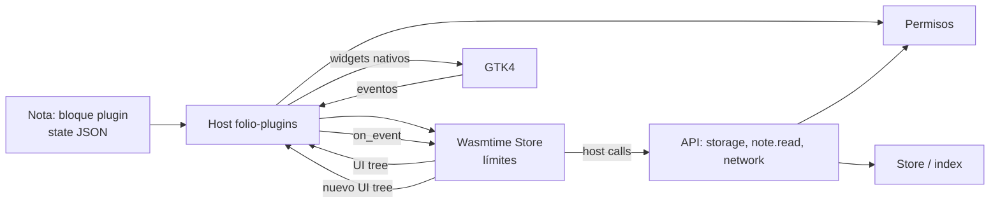

# 06 — Sistema de plugins

## 1. Objetivo

Permitir que terceros (y el propio autor) añadan **bloques, paneles, comandos, gráficas y diagramas** sin comprometer la seguridad ni el rendimiento. Un plugin debe poder instalarse desde un archivo, funcionar offline, pedir solo los permisos que necesita y fallar sin tumbar la aplicación.

## 2. Principios

1. **Aislamiento**: el plugin es WebAssembly; no hay acceso ambiental al sistema.
2. **Capacidades explícitas**: cada permiso se declara, se muestra y se puede revocar.
3. **UI nativa**: el plugin describe la interfaz; Folio la renderiza con GTK. Sin HTML/CSS/JS de plugin en el documento.
4. **Contrato versionado**: WIT con semver; un plugin declara la API que usa.
5. **Datos del usuario primero**: un plugin no puede leer ni escribir notas fuera de lo concedido.
6. **Degradación elegante**: plugin ausente, desactivado o caído → marcador, no pérdida de datos.
7. **Rendimiento acotado**: memoria, CPU, tamaño de UI y frecuencia de actualización limitados.

## 3. Arquitectura



- `folio-plugins` no depende de GTK; produce un árbol de UI abstracto.
- `folio-ui` tiene un renderizador que mapea ese árbol a widgets y aplica el tema.
- El estado del bloque se guarda en la nota; el estado privado en el KV del plugin.
- Cada plugin tiene un `PluginInstance` por bloque/panel visible; se destruye al salir de pantalla.

## 4. Paquete de plugin

```text
mi-plugin.folio-plugin        # zip
├── manifest.toml
├── plugin.wasm               # componente WebAssembly
├── signature.ed25519         # firma del manifiesto + wasm
├── README.md
├── LICENSE
└── assets/                   # iconos opcionales (PNG/SVG)
```

### 4.1 Manifiesto

```toml
schema = 1
id = "io.github.leonisauro.chart"
name = "Gráficas"
version = "1.0.0"
api = "1.0"
description = "Gráficas de barras, líneas y tarta a partir de tablas o datos."
author = "León"
license = "MIT"
homepage = "https://example.com/chart"
entry = "plugin.wasm"
icon = "assets/icon.svg"

[permissions]
note_read = true
network = false
clipboard = false

[contributes.blocks]
chart = { name = "Gráfica", icon = "chart", default_height = 280 }

[contributes.panels]
chart_help = { name = "Ayuda de gráficas", icon = "help" }

[contributes.commands]
insert_chart = { name = "Insertar gráfica", icon = "chart" }

[settings]
kind = { type = "enum", values = ["bar", "line", "pie"], default = "bar", label = "Tipo" }
title = { type = "string", default = "", label = "Título" }
```

Reglas:

- `id` en formato inverso, estable, sin cambios entre versiones.
- `version` semver; `api` semver de la API de Folio.
- `entry` debe ser un `.wasm` dentro del paquete; sin rutas absolutas ni `..`.
- Los assets se validan por tamaño y tipo; SVG se sanea.
- El manifiesto se valida contra JSON Schema antes de instalar.

### 4.2 Firma

- Ed25519 sobre `manifest.toml + plugin.wasm` (hash de ambos).
- `allow_unsigned = false` por defecto: un plugin sin firma no se instala salvo que el usuario lo permita explícitamente y vea el aviso.
- Al instalar se muestra la huella de la clave; se puede confiar en ella.
- Las actualizaciones deben usar la misma clave; si cambia, se trata como plugin nuevo y se pide confirmación.
- No hay marketplace en MVP; se instala desde archivo o carpeta de desarrollo.

## 5. Contrato WIT

> Borrador de la API 1.0. Se congela en la etapa E10 tras implementar los tres ejemplos del MVP; `quickbar` y `stats` se añaden en 1.0 sin cambiar el contrato.

```wit
package folio:plugin@1.0.0;

interface types {
  type note-id = string;
  type block-id = string;
  type instance-id = u64;

  record note-snapshot {
    id: note-id,
    title: string,
    book-title: string,
    text: string,
    blocks: list<block-summary>,
  }

  record block-summary {
    id: block-id,
    kind: string,
    text: string,
  }

  variant permission-error {
    denied(string),
    not-found(string),
    limit(string),
  }

  variant host-error {
    permission(permission-error),
    internal(string),
    timeout,
  }
}

interface ui {
  variant node {
    text(text-node),
    button(button-node),
    text-input(input-node),
    number-input(number-node),
    toggle(toggle-node),
    slider(slider-node),
    select(select-node),
    progress(progress-node),
    separator,
    spacer(spacer-node),
    row(container),
    column(container),
    grid(grid),
    scroll(scroll),
    card(card),
    table(table),
    chart(chart),
    canvas(canvas),
    image(image),
    tabs(tabs),
  }

  record text-node { id: string, value: string, style: string, wrap: bool }
  record button-node { id: string, label: string, icon: option<string>, disabled: bool, kind: string }
  record input-node { id: string, value: string, placeholder: string, multiline: bool }
  record number-node { id: string, value: f64, min: f64, max: f64, step: f64 }
  record toggle-node { id: string, value: bool, label: string }
  record slider-node { id: string, value: f64, min: f64, max: f64, step: f64, label: string }
  record select-node { id: string, value: string, options: list<option>, label: string }
  record option { value: string, label: string }
  record progress-node { id: string, value: f64, max: f64, label: string }
  record spacer-node { size: u32 }
  record container { id: string, children: list<node>, gap: u32, align: string }
  record grid { id: string, columns: u32, children: list<node> }
  record scroll { id: string, child: node, height: u32 }
  record card { id: string, title: string, child: node }
  record table { id: string, columns: list<string>, rows: list<list<string>> }
  record chart { id: string, kind: string, title: string, labels: list<string>, series: list<series> }
  record series { name: string, values: list<f64>, color: option<string> }
  record canvas { id: string, width: u32, height: u32, commands: list<draw-command> }
  record image { id: string, asset: string, alt: string, width: u32, height: u32 }
  record tabs { id: string, tabs: list<tab>, selected: u32 }
  record tab { id: string, label: string, child: node }

  variant draw-command {
    rect(rect),
    round-rect(round-rect),
    line(line),
    path(path),
    text(draw-text),
    circle(circle),
  }
  record rect { x: f64, y: f64, w: f64, h: f64, color: string, stroke: f64 }
  record round-rect { x: f64, y: f64, w: f64, h: f64, r: f64, color: string, stroke: f64 }
  record line { x1: f64, y1: f64, x2: f64, y2: f64, color: string, width: f64 }
  record path { points: list<point>, color: string, width: f64, fill: bool }
  record point { x: f64, y: f64 }
  record draw-text { x: f64, y: f64, value: string, size: f64, color: string, anchor: string }
  record circle { x: f64, y: f64, r: f64, color: string, stroke: f64 }
}

interface host {
  use types.{note-snapshot, host-error};
  use ui.{node};

  log: func(level: string, message: string);
  storage-get: func(key: string) -> option<list<u8>>;
  storage-set: func(key: string, value: list<u8>) -> result<_, host-error>;
  storage-delete: func(key: string) -> result<_, host-error>;
  storage-list: func(prefix: string) -> list<string>;

  note-get: func(id: string) -> result<note-snapshot, host-error>;
  note-current: func() -> result<note-snapshot, host-error>;
  note-insert-block: func(after: option<string>, block-json: string) -> result<string, host-error>;
  note-update-plugin-state: func(instance: instance-id, state: string) -> result<_, host-error>;

  asset-read-meta: func(hash: string) -> result<asset-meta, host-error>;
  asset-export: func(hash: string) -> result<string, host-error>;

  http-get: func(url: string) -> result<http-response, host-error>;

  clipboard-read: func() -> result<string, host-error>;
  clipboard-write: func(text: string) -> result<_, host-error>;
  notify: func(title: string, body: string);

  now: func() -> string;
  random-bytes: func(len: u32) -> list<u8>;
}

world plugin {
  import host;
  export init: func(context: init-context) -> result<_, string>;
  export render-block: func(instance: instance-id, state: string, width: u32, height: u32) -> result<node, string>;
  export render-panel: func(instance: instance-id, state: string) -> result<node, string>;
  export on-event: func(instance: instance-id, event: ui-event) -> result<action, string>;
  export commands: func() -> list<command-descriptor>;
  export run-command: func(id: string) -> result<command-result, string>;
  export settings-ui: func() -> node;
  export migrate: func(from-version: u32, data: list<u8>) -> result<list<u8>, string>;
}
```

### 5.1 Eventos

```wit
record ui-event {
  node-id: string,
  kind: string,          // click, change, submit, select, custom
  value: string,
}
variant action {
  none,
  update-state(string),          // nuevo JSON del bloque
  set-ui(node),                  // re-render inmediato
  insert-block(string),          // JSON de bloque, con confirmación del host
  notify(notification),
  open-url(string),
  run-command(string),
}
```

- El host aplica el `action` si el permiso lo permite.
- `update-state` se guarda en la nota con debounce; es undoable.
- `set-ui` se limita a 60 veces por segundo; el host descarta excesos.
- Los eventos llevan el `node-id` para que el plugin sepa qué cambió.

## 6. UI declarativa

### 6.1 Componentes

| Componente | Uso | Notas |
|---|---|---|
| `text` | Etiquetas, párrafos | Estilos: `body`, `caption`, `title`, `mono` |
| `button` | Acciones | `kind`: `normal`, `suggested`, `destructive`, `flat` |
| `text-input` | Texto | Multilínea opcional |
| `number-input` | Números | Min/max/step |
| `toggle` | Booleanos | |
| `slider` | Rango | |
| `select` | Opciones | |
| `progress` | Barra de progreso | Accesible |
| `separator`, `spacer` | Layout | |
| `row`, `column`, `grid` | Layout | Gap y alineación |
| `scroll` | Área desplazable | Altura máxima |
| `card` | Agrupación | Título |
| `table` | Datos tabulares | Solo lectura en 1.0 |
| `chart` | Gráficas nativas | Bar/line/pie |
| `canvas` | Dibujo de plugin | Comandos 2D, sin acceso a píxeles |
| `image` | Asset de la bóveda | Solo lectura |
| `tabs` | Pestañas | |

- Profundidad máxima 32; nodos máximos 5,000; texto máximo 1 MB por nodo.
- Los IDs deben ser únicos en el árbol; el host usa diff por ID.
- El tema lo aplica el host; el plugin solo sugiere colores de la paleta permitida.
- No hay HTML, CSS ni JavaScript en la UI del plugin.
- `canvas` es un lienzo de dibujo, no un WebView: comandos validados y coordenadas acotadas.

### 6.2 Renderizado

1. El plugin devuelve un árbol.
2. El host valida tipos, límites y unicidad de IDs.
3. `folio-ui` compara con el árbol anterior y actualiza solo los widgets cambiados.
4. Los widgets se crean con clases de Libadwaita; las fuentes y colores siguen el tema.
5. Si la validación falla, se muestra un error del plugin y no se aplica el árbol.

## 7. Permisos

| Permiso | Qué permite | Riesgo | Default |
|---|---|---|---|
| `note.read` | Leer la nota actual y notas por ID | Privacidad | No |
| `note.read_all` | Leer cualquier nota de la bóveda | Alto | No |
| `note.insert` | Insertar un bloque en la nota actual (con confirmación) | Integridad | No |
| `storage` | KV privado del plugin (≤ 10 MB) | Bajo | Sí |
| `assets.read` | Leer metadatos/assets referenciados | Medio | No |
| `network` | HTTP GET/POST a URLs permitidas | Alto | No |
| `clipboard.read` | Leer portapapeles | Alto | No |
| `clipboard.write` | Escribir portapapeles | Bajo | No |
| `notifications` | Enviar notificaciones | Bajo | No |
| `timer` | Temporizadores en segundo plano | Medio | No |

- Los permisos se declaran en el manifiesto y se muestran al instalar con una explicación.
- Se pueden revocar después; el plugin se reinicia y las llamadas fallan con `denied`.
- `network` exige lista de dominios en el manifiesto; el host rechaza otros.
- Un plugin no puede leer archivos directamente; `asset-export` copia a una ruta elegida por el usuario mediante portal.
- `note.insert` requiere confirmación del usuario la primera vez por sesión y muestra el bloque a insertar.

## 8. Límites y aislamiento

| Recurso | Límite |
|---|---|
| Memoria | 64 MB por defecto (configurable) |
| CPU por llamada | 2 s; render 50 ms |
| Instrucciones | 10M fuel por llamada |
| Tamaño wasm | 8 MB |
| Tamaño UI | 5,000 nodos, profundidad 32 |
| Estado por bloque | 1 MB |
| Storage | 10 MB por plugin |
| Llamadas de red | 10/min, 5 MB por respuesta |
| Logs | 1 MB por sesión |
| Hilos | Prohibidos |
| WASI | Sin filesystem, sin red, sin entorno; solo reloj/random controlados |

- Wasmtime con `StoreLimits`, `epoch_interruption` y `fuel`.
- Un plugin que excede el tiempo se interrumpe y se marca como fallido; no bloquea la UI.
- Los paneles se destruyen al cerrarse; los bloques al salir de pantalla.
- El host captura panics del plugin y devuelve error.

## 9. Ciclo de vida

```text
instalar → validar manifiesto → verificar firma → pedir permisos
 → extraer a plugins/<id>/ → registrar en índice → habilitar
 → cargar on demand → init → render / eventos
 → deshabilitar (descarga) → desinstalar (conserva datos si se pide)
```

- **Instalar**: desde archivo `.folio-plugin` o carpeta en modo dev.
- **Actualizar**: misma ID, versión mayor; migración de estado con `migrate`; backup del estado anterior.
- **Deshabilitar**: los bloques muestran marcador; el estado se conserva.
- **Desinstalar**: pide conservar o borrar datos; los bloques quedan como «plugin ausente».
- **Recargar** (dev): watcher de archivos, recompila y reinicia.
- **Aislar**: un plugin que falla 3 veces se deshabilita automáticamente y se notifica.

## 10. Plugins de ejemplo

> **MVP (obligatorios)**: `progress`, `chart` y `diagram`, que cubren barra, gráficas y diagramas. **1.0**: `quickbar` y `stats` completan los cinco.

### 10.1 `progress` — barra de progreso

- Bloque con etiqueta, valor, máximo y color.
- UI: `progress` + `text` + controles en panel de edición.
- Estado: `{ "value": 3, "max": 10, "label": "Capítulos" }`.
- Sin permisos.
- Demuestra: bloque, estado, eventos, render.

### 10.2 `chart` — gráficas

- Tipos: barras, líneas, tarta.
- Fuente: tabla de la nota (por ID de bloque) o datos inline.
- Permiso: `note.read` para leer la tabla.
- UI: `chart` nativo + selector de tipo + título.
- Estado: `{ "kind": "bar", "source": "table:<id>", "title": "Ventas" }`.
- Demuestra: lectura de nota, permisos, gráficas nativas, actualización al cambiar la tabla.

### 10.3 `diagram` — diagramas

- DSL:

```text
A[Inicio] -> B{¿Listo?}
B -- sí --> C[Fin]
B -- no --> A
```

- Layout por capas (Sugiyama simplificado) dentro del plugin.
- Render con `canvas`; clic en nodo emite evento y resalta.
- Panel lateral para editar el DSL y elegir dirección.
- Sin permisos (solo su bloque).
- Demuestra: canvas de plugin, eventos interactivos, panel lateral.

### 10.4 `quickbar` — barra rápida (1.0)

- Panel lateral con botones configurables: nueva nota, insertar tabla, abrir hoy, ejecutar comando.
- Permisos: `note.insert` (opcional), comandos del host.
- Demuestra: panel, comandos, integración con la app.

### 10.5 `stats` — estadísticas (1.0)

- Panel con notas creadas por día, palabras, rachas y tipos de bloque.
- Permiso: `note.read_all`.
- Datos agregados localmente; sin red.
- Demuestra: lectura de la bóveda, visualización, privacidad.

> El plugin «barra» solicitado se cubre con `progress` (barra de progreso, MVP) y `quickbar` (barra de acciones, 1.0). La API no cambia entre ambos.

## 11. SDK y desarrollo

### 11.1 SDK Rust

```bash
cargo install cargo-folio
cargo folio new --name chart --id io.github.yo.chart
cd chart
cargo folio dev --vault ~/Notas
cargo folio build --release
cargo folio test
```

- `folio-plugin-sdk` expone builders para UI, eventos, storage y settings.
- `cargo folio new` genera manifiesto, WIT, lib.rs y un test.
- `cargo folio dev` compila a wasm32-wasip2/componente, instala en modo dev y recarga.
- `cargo folio test` ejecuta el arnés con un host simulado y snapshots de UI.
- `cargo folio pack` firma y crea `.folio-plugin`.

### 11.2 SDK TypeScript (1.0)

- Componentize-JS/JCO para autores web.
- Mismo contrato WIT; UI builders tipados.
- No entra en MVP si retrasa los tres ejemplos; se documenta como camino posterior.

### 11.3 Depuración

- Logs del plugin en `~/.local/state/folio/plugins/<id>.log`.
- Visor de logs en el gestor.
- Modo dev: recarga, inspección del árbol UI y eventos.
- `folio plugin validate ./x.folio-plugin`.
- `folio plugin test ./x.folio-plugin` ejecuta conformidad.

## 12. Seguridad

- El plugin no puede abrir archivos, sockets ni procesos; solo funciones del host.
- El host valida cada URL, ruta, tamaño y tipo.
- La UI no puede inyectar HTML; los textos se escapan/renderizan con Pango.
- Los assets de plugin se validan (PNG/SVG saneado); SVG sin scripts.
- La firma protege la cadena de suministro; la ausencia de firma es visible.
- Los permisos se registran en un log de auditoría local.
- Un plugin malicioso puede como máximo: leer lo que se le concedió, gastar CPU/RAM dentro de límites y mostrar UI fea. No puede ejecutar comandos, borrar archivos ni exfiltrar sin `network`.
- Pruebas obligatorias: intento de path traversal, apertura de socket, lectura de nota sin permiso, UI gigante, bucle infinito, panic, memoria excesiva.

## 13. Versionado y compatibilidad

- `api = "1.0"`; el host rechaza plugins con API mayor.
- Dentro de 1.x se añaden funciones opcionales; no se rompen firmas.
- `migrate(from_version, data)` permite actualizar el estado del bloque.
- El estado del plugin en la nota lleva `schema`; si es mayor, se muestra marcador y no se toca.
- Los plugins firmados con una clave nueva requieren confirmación.
- El contrato WIT se publica en el repo y se versiona con el SDK.

## 14. Criterios de aceptación

- [ ] Instalar, habilitar, deshabilitar y desinstalar un plugin desde la UI.
- [ ] Los tres ejemplos del MVP (`progress`, `chart`, `diagram`) funcionan en una nota real y en CI.
- [ ] Los cinco ejemplos funcionan en 1.0.
- [ ] Un plugin sin `network` no puede hacer peticiones.
- [ ] Un plugin que intenta leer `/etc/passwd` falla y se registra.
- [ ] Un bucle infinito se corta a los 2 s sin congelar la UI.
- [ ] Un panic del plugin no cierra la app.
- [ ] El estado del bloque sobrevive a desinstalar/reinstalar.
- [ ] La UI del plugin respeta tema, escala y teclado.
- [ ] Un tercero crea un plugin siguiendo solo la guía.
- [ ] La API 1.0 queda congelada y documentada.


## Estado de la API 1.0

La API `api = 1` está congelada. El host valida manifiesto, versión semver, IDs de
bloques/comandos y UI (profundidad ≤ 32, nodos ≤ 2000). Los cinco plugins de
referencia (`progress`, `chart`, `diagram`, `stats`, `quickbar`) cubren el catálogo
1.0. Los binarios WASM de terceros quedan detrás de `PluginRuntime` (ADR-023); el
contrato y el paquete no cambian al habilitar Wasmtime.


## Runtime WASM de terceros (1.0)

`folio_plugins::wasm::WasmRuntime` ejecuta módulos core WebAssembly con el ABI
JSON `api = 1`:

```text
folio_api_version() -> i32
folio_alloc(len: i32) -> i32
folio_handle(req_ptr: i32, req_len: i32) -> i32
folio_result_ptr() -> i32
folio_result_len() -> i32
memory (exportada)
```

El host crea una instancia nueva por llamada, aplica fuel/memoria/tiempo, valida
la UI y expone solo funciones de host con permisos. Ejemplo real:
`plugins/hello` (`plugin.wat` + `plugin.wasm`). Los módulos no tienen WASI,
sistema de archivos ni red ambiental.
